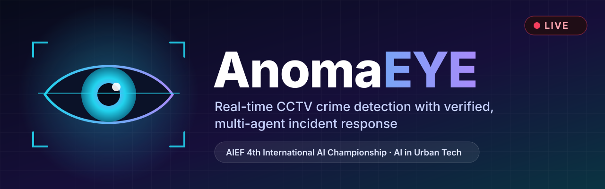
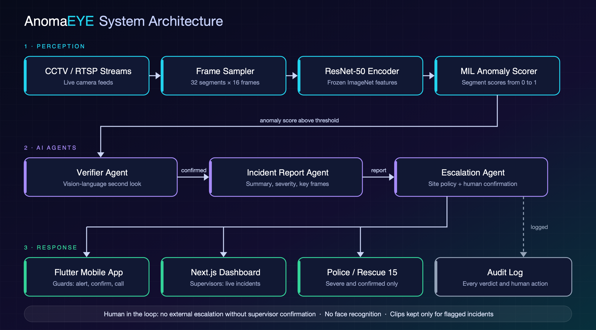
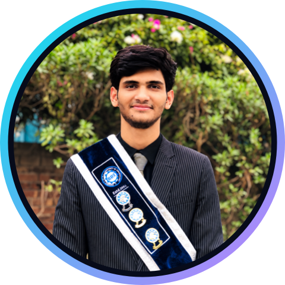

  

  
  &nbsp;
  
  &nbsp;
  

  
  
  
  

<h3 align="center">Thousands of cameras. A handful of eyes. AnomaEYE watches every feed, double-checks every alarm, and gets the right person moving in seconds.</h3>

 

## ✦ Overview

**AnomaEYE** turns passive CCTV recording into active, verified security. It watches live camera streams, flags crimes and anomalous events as they happen, has a vision-language verifier take a second look before anyone is disturbed, attaches a keyframe, a clip and a one-sentence description to every event, alerts guards on their phones by push and SMS, sounds a siren on site for severe cases, and keeps supervisors in the loop on a live dashboard with a full audit trail of every alert and every human action.

> **Product landing page, with the full flow: [www.anomaeye.com](https://www.anomaeye.com)**

 

## 📊 Why it matters

<table>
  <tr>
    <td align="center" width="33%">
      <h1>8,000+</h1>
      Safe City CCTV cameras in Lahore alone, watched from one control room
    </td>
    <td align="center" width="33%">
      <h1>171,784</h1>
      crimes reported across Punjab in 2025, including 25,010 robberies
    </td>
    <td align="center" width="33%">
      <h1>1 : many</h1>
      one guard per wall of screens on most private premises; footage is reviewed only after the fact
    </td>
  </tr>
</table>

Sources: <a href="https://arynews.tv/punjab-cm-inaugurates-lahore-safe-city-project">ARY News</a>, <a href="https://www.thenews.pk/print/1402651-punjab-records-32pc-drop-in-crime">The News</a>.

 

## ⚡ What AnomaEYE does

<table>
  <tr>
    <td width="33%" valign="top">
      <h3>🎥 Real-time detection</h3>
      Two video encoders and a temporal model score every second of every stream for fights, assault, robbery, vandalism, arson, road accidents and other anomalies.
    </td>
    <td width="33%" valign="top">
      <h3>🧠 Verifier</h3>
      A vision-language model double-checks each candidate and writes one sentence on what it sees, cutting the false alarms that make operators stop trusting analytics.
    </td>
    <td width="33%" valign="top">
      <h3>📝 Evidence on every alert</h3>
      Keyframe, short clip, description, severity, camera and time, stored privately and shared by short-lived links.
    </td>
  </tr>
  <tr>
    <td width="33%" valign="top">
      <h3>📱 Mobile alerts</h3>
      Flutter app for security staff: live cameras, push alert with the clip, acknowledge, escalate or resolve.
    </td>
    <td width="33%" valign="top">
      <h3>🖥️ Admin dashboard</h3>
      React web dashboard with the live incident feed, staff and camera management, alert settings and the audit log.
    </td>
    <td width="33%" valign="top">
      <h3>🚨 Four alert channels</h3>
      Push, SMS, email and an on-site siren, each sent once per verified event. Escalation is a human decision, recorded in the audit trail.
    </td>
  </tr>
</table>

 

## 🔄 How it works

| Step | What happens |
|:---:|---|
| **1** | A small agent on site forwards each camera's stream to the cloud media server; the GPU service pulls it from there |
| **2** | The **scene gate** scores every second of every camera and proposes candidate events |
| **3** | The **verifier**, a vision-language model, looks at 8 frames of each candidate, confirms or vetoes it, and writes a one-sentence description |
| **4** | Confirmed events reach the backend with a keyframe and clip; the backend cuts the evidence clip from its rolling buffer and stores the event |
| **5** | Staff are alerted by push, SMS and email, and a siren sounds on site for severe events; the apps update live |
| **6** | Every verdict and every human action (acknowledge, escalate, resolve) is written to an append-only audit log per organisation |

 

## 🏗️ System architecture

  

 

## 🔬 Research foundation: STAGE

The detection backbone of AnomaEYE follows the approach of our research paper:

<table>
  <tr>
    <td width="96" align="center" valign="middle">
      
    </td>
    <td valign="middle">
      <b>STAGE: Splice-Supervised Temporal Anchoring for Generalization and Explainability in Video Anomaly Detection</b> 
      Under review at <b>Image and Vision Computing (IVC)</b>, Elsevier
    </td>
  </tr>
</table>

STAGE studies **weakly supervised video anomaly detection** and the problem every real deployment faces: a model trained on one set of cameras has to work on new scenes, angles, lighting and video quality.

**Key ideas in the paper**

- **Latent Temporal Splicing:** anomaly-related latent temporal segments are spliced in during training to create additional learning signals and reduce the model's dependence on source-specific video context.
- **Semantic guidance for donor selection:** semantic video features decide which segments are spliced together.
- **Appearance, motion and semantic streams:** X3D-M for spatio-temporal appearance, RAFT-small for motion, InternVideo2-CLIP for semantics.
- **Multiple Instance Learning** with temporal modelling for anomaly scoring and **temporal localisation** of when the event happens.
- **Cross-dataset evaluation** for generalisation, on UCF-Crime, MSAD, XD-Violence and ShanghaiTech.

**From paper to product: deployment adjustments**

The live system keeps the STAGE approach and adapts it for real-time, multi-camera serving:

| | STAGE paper | AnomaEYE deployment |
|---|---|---|
| Feature streams | X3D-M + RAFT-small + InternVideo2-CLIP | X3D-M + InternVideo2-CLIP (two frozen video encoders) |
| Temporal model | MIL with temporal modelling on whole videos | Causal temporal transformer scoring every second over a live rolling window, so training on clips and serving live are the same computation |
| Output | Anomaly scores and temporal localisation | Per-second anomaly probability, a coarse group (violence, weapon, fire, vehicle, theft, incident) and a fine crime class |
| Robustness | Single model, cross-dataset evaluation | Ensemble of eight independently trained models, calibrated, with hysteresis and a per-camera adaptive baseline |
| Decision | Benchmark scoring | Candidates are confirmed or vetoed by a vision-language verifier before any alert is sent |

  
  
  
  

 

## 🧰 Built with

  
  
  
  
  
  
  

 

## 🛡️ Responsible by design

- **No face recognition** and no identity matching.
- **Verified before anyone is disturbed:** a second model must confirm an alert; escalation beyond the team is a human decision.
- **Minimal retention:** video sits in a 5-minute rolling buffer; only the window around a confirmed event is kept, for a configurable period.
- **Accountable:** every model output and human decision is logged and attributable.

 

## 👥 Team

<table align="center">
  <tr>
    <td align="center" width="260" valign="top">
        
      <b>M. Talha Farooqi</b> 
      AI Engineer  
      &nbsp;
      &nbsp;
      
    </td>
    <td align="center" width="260" valign="top">
        
      <b>Muhammad Husnain Aslam</b> 
      Backend Engineer  
      &nbsp;
      &nbsp;
      
    </td>
    <td align="center" width="260" valign="top">
        
      <b>Chaudhary Shoaib Hamza</b> 
      Flutter Developer · Founder, Big Brains  
      &nbsp;
      &nbsp;
      
    </td>
  </tr>
</table>

  <b>University of Management and Technology (UMT)</b> · BS Software Engineering · Graduated (July 2026) 
  Project supervisor: <b>Dr. Syed Farooq Ali</b>

 

## 🏆 AIEF 4th International AI Championship

AnomaEYE is competing in the **[AI Showdown, 4th International AI Championship](https://www.aiedu.org.pk/4th-international-ai-championship/)** organised by the Artificial Intelligence Education Foundation, in the **AI in Urban Tech** category. Grand finale: **24 October 2026, FAST-NUCES Lahore**.

 

  &nbsp;&nbsp;
  
    
  Built in Lahore, Pakistan 🇵🇰 · © 2026 Team AnomaEYE

