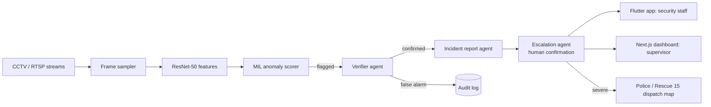

# AnomaEYE — Real-Time CCTV Crime Detection with Verified, Multi-Agent Incident Response

Submission to the **[4th International AI Championship (AI Showdown)](https://www.aiedu.org.pk/4th-international-ai-championship/)** by the Artificial Intelligence Education Foundation (AIEF), finale 24 October 2026 at FAST-NUCES, Lahore.

**Category:** AI in Urban Tech  
**Full proposal:** [docs/AnomaEYE_Proposal.md](docs/AnomaEYE_Proposal.md)  
**Demo video:** _[add link]_

## What it does

AnomaEYE watches live CCTV streams, scores video for anomalous or criminal activity, double-checks every detection with a vision-language verifier agent, writes an incident report with key frames, alerts security staff on a Flutter mobile app, shows supervisors a Next.js dashboard, and, for severe confirmed incidents only, escalates to the nearest police station or emergency office with human confirmation and a full audit log.

## Team

| Name | Designation | GitHub | LinkedIn | Email |
|---|---|---|---|---|
| **M. Talha Farooqi** | AI Engineer (team lead) | [M-Talha-Farooqi](https://github.com/M-Talha-Farooqi) | [m-talha-farooqi](https://www.linkedin.com/in/m-talha-farooqi) | [the.mtalhafarooqi@gmail.com](mailto:the.mtalhafarooqi@gmail.com) |
| **Muhammad Husnain Aslam** | Backend Engineer | [heyhusn](https://github.com/heyhusn) | [husnain-aslam-0a959a1a7](https://www.linkedin.com/in/husnain-aslam-0a959a1a7) | [mhusnainaslam2003@gmail.com](mailto:mhusnainaslam2003@gmail.com) |
| **Chaudhary Shoaib Hamza** | Flutter Developer / Founder, Big Brains | [theshoaibhamza](https://github.com/theshoaibhamza) | [shoaibhamza](https://www.linkedin.com/in/shoaibhamza) | [chaudharyshoaibhamza@gmail.com](mailto:chaudharyshoaibhamza@gmail.com) |

## Architecture



- **Detection core:** frozen ImageNet ResNet-50 features (32 segments × 16 frames per window) scored by a weakly supervised multiple-instance-learning MLP trained on UCF-Crime. Model code and weights: [M-Talha-Farooqi/res_NET_50](https://github.com/M-Talha-Farooqi/res_NET_50).
- **Agentic response layer:** verifier, incident-report and escalation agents with structured JSON outputs and an append-only audit log.
- **Apps:** Flutter mobile app for guards; Next.js dashboard for supervisors; Python inference service plus REST/WebSocket backend.

## Repository layout

```
README.md                      ← this file
docs/AnomaEYE_Proposal.md      ← the proposal submitted to the championship form
docs/                          ← architecture images, evaluation tables, demo links (add as produced)
```

Application source code (model, backend, mobile app, web dashboard) lives in the team's project repositories; links will be added here as they are made public.

## Run the demo

```bash
# 1. Anomaly scorer on a video file or RTSP stream (model repo)
git clone https://github.com/M-Talha-Farooqi/res_NET_50 && cd res_NET_50
pip install -r requirements.txt
python inference.py --source path/to/video.mp4   # or rtsp://...

# 2. Backend, dashboard and mobile app: see their respective repositories (links to be added)
```

## Roadmap to the finale (24 Oct 2026)

- [ ] Verifier agent (vision-language second look) wired into the alert path
- [ ] Incident report agent with key frames
- [ ] Dispatch map with nearest police station / Rescue 15 routing
- [ ] Evaluation tables: UCF-Crime AUC, false alarms per camera-hour (with and without verifier), alert latency
- [ ] Offline fallback and recorded backup demo

## Contact

M. Talha Farooqi — [the.mtalhafarooqi@gmail.com](mailto:the.mtalhafarooqi@gmail.com)
