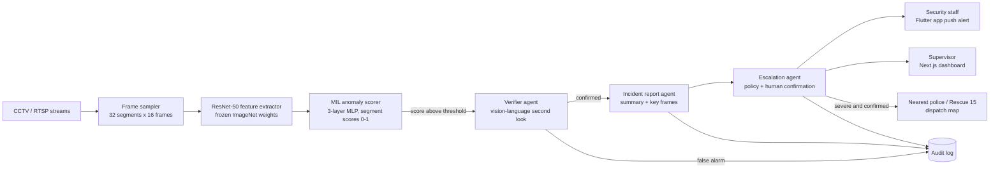

# AnomaEYE — Real-Time CCTV Crime Detection with Verified, Multi-Agent Incident Response

**Submission for:** [4th International AI Championship (AI Showdown), Artificial Intelligence Education Foundation](https://www.aiedu.org.pk/4th-international-ai-championship/)
**Category:** AI in Urban Tech (smart-city infrastructure, mobility, and civic systems)
**Keywords:** video anomaly detection, real-time CCTV surveillance, multi-agent incident response, Safe City, crime detection
**Repository:** https://github.com/M-Talha-Farooqi/AIEF_Hackathon_2026
**Demo video:** _[add YouTube unlisted link]_

---

## Team

| # | Name | Designation | Email | GitHub | LinkedIn |
|---|---|---|---|---|---|
| 1 | **M. Talha Farooqi** | AI Engineer (team lead) | [the.mtalhafarooqi@gmail.com](mailto:the.mtalhafarooqi@gmail.com) | [github.com/M-Talha-Farooqi](https://github.com/M-Talha-Farooqi) | [linkedin.com/in/m-talha-farooqi](https://www.linkedin.com/in/m-talha-farooqi) |
| 2 | **Muhammad Husnain Aslam** | Backend Engineer | [mhusnainaslam2003@gmail.com](mailto:mhusnainaslam2003@gmail.com) | [github.com/heyhusn](https://github.com/heyhusn) | [linkedin.com/in/husnain-aslam-0a959a1a7](https://www.linkedin.com/in/husnain-aslam-0a959a1a7) |
| 3 | **Chaudhary Shoaib Hamza** | Flutter Developer / Founder, Big Brains | [chaudharyshoaibhamza@gmail.com](mailto:chaudharyshoaibhamza@gmail.com) | [github.com/theshoaibhamza](https://github.com/theshoaibhamza) | [linkedin.com/in/shoaibhamza](https://www.linkedin.com/in/shoaibhamza) |

**Institution / programme:** _[University, degree programme, expected graduation 2026 — required for eligibility proof]_
**Faculty supervisor:** _[Name, department — add if applicable]_

---

## 1. Problem statement

Pakistan's cities have invested heavily in cameras but not in watching them. The Lahore Safe City project alone installed 8,023 CCTV cameras at a cost of about Rs 12 billion ([ARY News](https://arynews.tv/punjab-cm-inaugurates-lahore-safe-city-project)), feeding a control room video wall of roughly 200 screens, and the Punjab Safe Cities Authority is now extending camera coverage to 21 cities ([Business Recorder](https://www.brecorder.com/news/amp/40286307)). A few dozen operators cannot watch thousands of feeds; in practice most footage is recorded, not monitored, and is reviewed only after a crime has been reported.

The volume of incidents makes this gap costly. Punjab recorded 171,784 reported crimes in 2025, including 25,010 robberies ([The News](https://www.thenews.pk/print/1402651-punjab-records-32pc-drop-in-crime)); Lahore alone logged 12,484 reported crimes in the first half of 2025 ([ARY News](https://arynews.tv/lahore-crime-statistics-drop-68-2025-signifying-improvements)). Private premises (housing societies, universities, hospitals, banks, factories) run their own camera networks with the same problem: one guard, many screens, no alert until someone complains.

**Why existing solutions fail here.** Commercial video analytics are priced for Western enterprises and tuned to Western footage; most offer motion or line-crossing alerts that drown operators in false alarms; and none close the loop from detection to a verified, logged response that reaches the right person on a phone. Academic anomaly detectors stop at a score on a benchmark.

## 2. Proposed solution

AnomaEYE turns passive CCTV recording into active, verified alerting. It watches live camera streams, scores every few seconds of video for anomalous or criminal activity (fighting, robbery, assault, vandalism, and similar events), and when something is detected it does what a good control room would do: a second model double-checks the clip, an incident report with key frames is written automatically, the right security staff are notified on their phones, a supervisor sees it on a web dashboard, and only for severe, confirmed incidents is the nearest police station or emergency office contacted, with a human confirmation step and a full audit trail.

**Why AI is necessary.** The bottleneck is human attention across thousands of streams; only a model can watch all of them at once. The bottleneck after detection is trust; only a verification step with explainable reasoning makes it safe to act on a machine alert.

## 3. System architecture

| Module / agent | Single responsibility | Inputs | Outputs | Tools |
|---|---|---|---|---|
| Stream ingester | Pull RTSP/file streams, sample 16 frames per segment, 32 segments per window | camera URLs | frame batches | OpenCV, FFmpeg |
| Feature extractor | Frozen ResNet-50 (ImageNet) embeddings | frames | (32, 2048) feature array per window | PyTorch |
| MIL anomaly scorer | Weakly supervised 3-layer MLP trained with MIL ranking + sparsity + temporal smoothness loss; video score = max segment score | features | per-segment anomaly scores | PyTorch |
| Verifier agent | Second, independent look at the flagged clip with a vision-language model; outputs what is happening, confidence, false-alarm flag, severity | clip + score | structured JSON verdict | LLM with vision, JSON schema |
| Incident report agent | One-paragraph incident summary, key frames, camera, time, severity | verdict + metadata | report object | LLM, image tools |
| Escalation agent | Applies the site's escalation policy: guard, then supervisor, then police/emergency; requires human confirmation for external escalation; never auto-dials below the configured severity | report | notifications, dispatch request | push notifications, SMS/voice gateway, hospital/police registry |
| Dispatch map | Nearest police station / Rescue 15 from a registry, route on OpenStreetMap | location | ETA and route | OSRM / Leaflet |
| Mobile app (Flutter) | Alerts, clip playback, confirm / dismiss, call buttons | reports | staff actions | Flutter |
| Web dashboard (Next.js) | Live camera wall, incident timeline, analytics, policy settings, audit log | all events | supervisor actions | Next.js |
| Backend API | Auth, event bus, storage, policy engine, audit log | all | all | Python inference service + REST/WebSocket API |

**Safety and human-in-the-loop.** The Verifier must confirm before any notification leaves the system. External escalation (police, Rescue 15) is off by default, enabled per site, and always shows a confirmation screen to the on-duty supervisor unless the site explicitly configures auto-escalation for the highest severity tier. Every decision, model output and human action is written to an append-only audit log.

## 4. Data

| Dataset | Use | Size / licence | Link |
|---|---|---|---|
| UCF-Crime | Train / test the weakly supervised anomaly scorer (anomaly vs. normal videos, UCF-Crime-style splits) | 1,900 untrimmed surveillance videos, 13 anomaly classes; research use | https://www.crcv.ucf.edu/projects/real-world/ |
| Local CCTV clips | Qualitative and false-alarm evaluation on Pakistani footage (lighting, camera angles, clothing, crowd density differ from UCF-Crime) | _[number of clips, hours, source — add]_ | internal |

Training uses video-level labels only (weak supervision), so no frame-level annotation was required. Local clips are used for evaluation, with faces not stored and clips deleted after the retention window.

## 5. Models and methods

- **Backbone:** ResNet-50 pre-trained on ImageNet, frozen. Each video window is split into 32 temporal segments of 16 sampled frames; frame features are averaged per segment to a 2048-d vector.
- **Detector:** 3-layer MLP with sigmoid output producing a score in (0, 1) per segment.
- **Objective:** multiple-instance-learning ranking loss between the highest-scoring segments of a normal and an anomalous video, plus sparsity and temporal-smoothness regularisers.
- **Training:** Adagrad, batch size 32 (normal–anomalous pairs), 50 epochs, checkpoints every 10 epochs.
- **Inference:** sliding window over the live stream; a window is flagged when its maximum segment score exceeds a site-configurable threshold; hysteresis across consecutive windows suppresses single-frame spikes.
- **Verifier agent:** a vision-language model receives the flagged clip's key frames and the scorer's output and must answer a fixed JSON schema (`event_type`, `confidence`, `is_false_alarm`, `severity`, `reasoning`). Disagreement between scorer and verifier is logged for retraining.
- **Why this design:** weak supervision makes training cheap and extensible to new sites; the frozen backbone keeps inference light enough for commodity GPUs or edge boxes; the verifier converts a bare score into an explainable, auditable decision.

## 6. Evaluation and results

| Metric | Value | Notes |
|---|---|---|
| Video-level AUC-ROC on UCF-Crime test split | _[fill from roc_curve.png]_ | standard benchmark for this task |
| False alarms per camera-hour, scorer only | _[fill]_ | measured on normal-only local footage |
| False alarms per camera-hour, scorer + Verifier agent | _[fill]_ | the number that decides deployability |
| Detection-to-phone-alert latency (median) | _[fill, seconds]_ | measured end to end on the Flutter app |
| Inference throughput | _[fill, streams per GPU]_ | hardware: _[GPU / edge device]_ |

**Ablation:** scorer alone vs. scorer + Verifier (false-alarm rate and missed-event rate); with vs. without temporal hysteresis.

**Known failure cases:** _[add one or two, with a frame each: e.g., crowd celebration misread as a fight; low-light footage with motion blur; camera shake]_. We show these because a deployable system must be honest about where it fails.

## 7. Prototype status (what works today)

- [x] Weakly supervised anomaly scorer trained on UCF-Crime (code and weights in the model repository)
- [x] Real-time inference pipeline over video streams
- [x] Flutter mobile app for security staff: push alerts, clip playback, confirm / dismiss
- [x] Next.js web dashboard for supervisors: live incidents, timeline, settings
- [x] Backend API: auth, event handling, storage
- [x] Escalation to police / other offices for severe cases (human-confirmed)
- [ ] Verifier agent (vision-language second look) — in progress for the finale
- [ ] Incident report agent — in progress for the finale
- [ ] Dispatch map with nearest-station routing — in progress for the finale

_Adjust the checkboxes above to match the exact state of the build at submission time._

**Run the demo (under 5 minutes):** see the README in this repository.

## 8. Real-world impact and deployment path

**First users.** Private-premises security teams where one guard watches many screens: housing societies, university campuses, hospitals, bank branches and factories in Lahore. **Second user:** Punjab Safe Cities Authority control rooms, as an assistive layer that ranks which feeds an operator should look at now.

**90-day pilot plan.** Month 1: deploy on 8 to 16 cameras at one campus or housing society, scorer plus Verifier, alerts to two guards and one supervisor, no external escalation. Month 2: measure false alarms per camera-hour and response time against the site's incident log; retrain on site footage. Month 3: enable supervisor-confirmed external escalation; publish results.

**Cost.** One commodity GPU server handles dozens of streams; apps run on existing phones; per-camera monthly cost is a fraction of one guard's salary.

**Sustainability and ethics.** No face recognition and no identity matching. Clips are retained only for a configurable window and only when an incident is flagged. Bias risk: UCF-Crime is largely non-Pakistani footage, so we evaluate on local clips and retrain with site data before enabling escalation. Misuse risk: policy engine and audit log make every escalation attributable to a person.

## 9. Novelty

- **Detection to response, not detection alone.** Most academic and student systems stop at an anomaly score; AnomaEYE ships the alerting, apps, escalation policy and audit trail needed to act on it.
- **Verified escalation.** A second, independent vision-language judgement with structured reasoning gates every alert, cutting the false-alarm problem that makes operators ignore analytics.
- **Built for Pakistani deployment.** Weak supervision lowers data cost, a frozen backbone keeps compute cheap, and the staff experience is a phone app, matching how security teams here actually work.

## 10. Team roles and timeline

| Member | Built | Before 24 Oct |
|---|---|---|
| M. Talha Farooqi | Anomaly model, training and inference pipeline, Verifier agent design | Verifier and report agents, evaluation tables, pitch |
| Muhammad Husnain Aslam | Backend API, event bus, storage, escalation policy engine | Dispatch map, audit log views, load testing |
| Chaudhary Shoaib Hamza | Flutter app, alert UX, confirm / dismiss flows | Finale demo build, offline fallback, poster |

**Timeline:** 12 Oct submission (this document and repository); 13 to 16 Oct agents and evaluation; 16 Oct shortlist; 17 to 23 Oct rehearsal, offline hardening, backup video; 24 Oct finale at FAST-NUCES Lahore.
